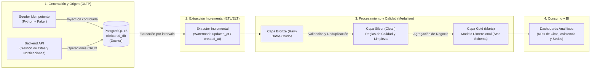

# Arquitectura End-to-End v1 - ClínicaRed Citas

## 1. Visión General
El sistema **ClínicaRed Citas** implementa una arquitectura híbrida que separa el procesamiento transaccional (OLTP) del flujo analítico de ingeniería de datos (OLAP). El diseño garantiza alta disponibilidad en la gestión de citas médicas, seguimiento de asistencia y mensajería, trazabilidad de calidad de datos y escalabilidad mediante contenedores.

## 2. Diagrama de Arquitectura (v1)

## 3. Componentes Principales

### 3.1 Capa Transaccional (Fuente de Datos)
* **Motor de Base de Datos:** PostgreSQL (`postgres:15-alpine`) ejecutándose en contenedor Docker aislado y aprovisionado automáticamente mediante `01_init_schema.sql`.
* **Esquema Relacional (3NF):** 
  * **Catálogos Maestros:** `locations` (sedes) y `specialties` (especialidades médicas).
  * **Entidades Operativas y Relación:** `professionals` (médicos), `patients` (pacientes) y la tabla puente `professional_specialties` (relación muchos a muchos).
  * **Núcleo Transaccional:** `appointments` (agendamiento de citas), `attendances` (control de asistencia, *check-in* y notas clínicas) y `messages` (registro de notificaciones y recordatorios enviados al paciente).
* **Auditoría Temporal Confiable:** Uso de columnas `created_at` y `updated_at` respaldadas por *triggers* nativos en PL/pgSQL (`update_updated_at_column()`) para garantizar la captura exacta de cambios de estado.
* **Generación Sintética (`generate_seed.py`):** Script idempotente en Python que puebla la base de datos e incorpora un parámetro configurable de inyección de defectos para pruebas de estrés en pipelines de calidad de datos.

### 3.2 Capa de Ingesta y Extracción
* **Estrategia de Extracción:** Extracción incremental basada en marcas de agua (*watermark*) utilizando las columnas de auditoría temporal (`updated_at` / `created_at`) e identificadores únicos (`id`) para evitar barridos completos (*Full Table Scans*), capturar cambios de estado (ej. citas canceladas, *check-ins* en `attendances` o envíos en `messages`) y manejar datos tardíos.

### 3.3 Capa de Transformación y Almacenamiento Analítico (Medallion)
* **Bronce (Raw):** Almacenamiento inmutable de los lotes extraídos desde la base transaccional.
* **Plata (Clean):** Aplicación de reglas de negocio, manejo de valores nulos, normalización de formatos (teléfonos, correos) y cuarentena de registros defectuosos.
* **Oro (Gold):** Modelado dimensional (Esquema Estrella) optimizado para consultas analíticas de rendimiento por sede, demanda por especialidad, efectividad de notificaciones (`messages`) y tasas de inasistencia (*no-show* en `attendances` vs `appointments`).