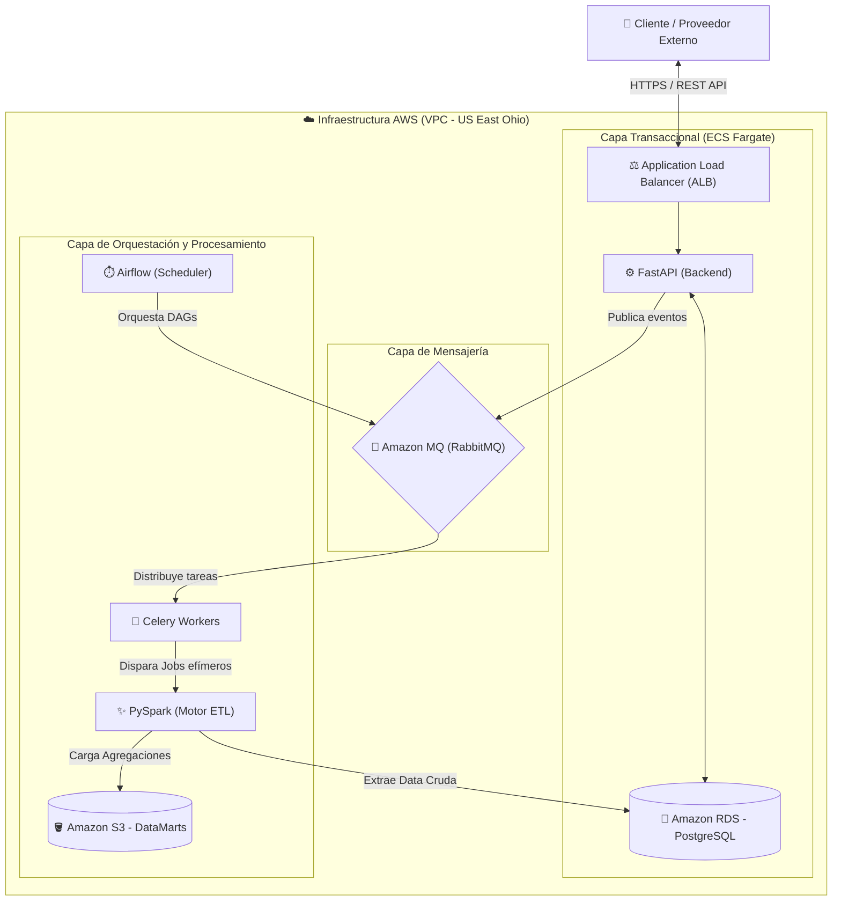

# Arquitectura End-to-End v2 - ClínicaRed en AWS

## 1. Visión General
El sistema **ClínicaRed Citas** ha evolucionado hacia una arquitectura híbrida, distribuida y *Serverless* para contenedores, alojada en la región **US East (Ohio)**. Se separan físicamente las responsabilidades transaccionales síncronas (OLTP) de los procesos asíncronos y cargas de trabajo de ingeniería de datos (OLAP). 

Según lo definido en la evaluación de infraestructura, se seleccionó la **Opción A - Contenedores ECS** con un costo base mensual estimado de **$50.12 USD**, garantizando alta disponibilidad y escalabilidad sin administrar servidores subyacentes.

## 2. Diagrama de Arquitectura (v2)

## 3. Componentes Principales y Costos Detallados

### 3.1 Capa Transaccional (Fuente de Datos y API)
Capa encargada del tráfico en tiempo real, validación de reglas de negocio (ej. *overbooking*), control de idempotencia y persistencia inmediata.

* **Application Load Balancer (ALB):** **$16.66 USD/mes**. Enruta de forma segura el tráfico HTTPS desde internet hacia los contenedores de backend.
* **AWS Fargate (Amazon ECS):** **$18.02 USD/mes**. Framework principal de la API de **FastAPI**. Configurado con sistema operativo Linux, arquitectura x86, 1 tarea constante (730 horas/mes), 1 GB de memoria asignada y 20 GB de almacenamiento efímero.
* **Motor de Base de Datos (Amazon RDS for PostgreSQL):** **$15.44 USD/mes**. Sustituye al contenedor de Docker local. Configurado con una instancia `db.t3.micro` OnDemand (Single-AZ), alojando 20 GB de almacenamiento SSD de uso general (`gp2`).
* **Reglas de Negocio e Idempotencia:** Endpoints protegidos mediante validación de `idempotency_key` para ignorar webhooks duplicados o desordenados de proveedores externos.

### 3.2 Capa de Mensajería (Message Broker)
Sistema nervioso central que permite la comunicación asíncrona entre el backend y los trabajadores en segundo plano.

* **RabbitMQ (Amazon MQ / Fargate):** Actúa como intermediario para las colas de Celery. Permite que `clinicared-backend` publique eventos (ej. `cita_creada`) y responda al usuario sin latencia, mientras retiene los mensajes de forma persistente hasta que el orquestador los procese.

### 3.3 Capa de Orquestación y Almacenamiento Analítico (OLAP)
Aislada completamente del backend para evitar que el procesamiento masivo afecte la API transaccional.

* **Orquestador (Apache Airflow + Celery):** Ejecutándose en contenedores aislados. Airflow planifica los DAGs (ej. `dag_daily_risk_calculation.py`) y Celery distribuye la carga de trabajo de forma paralela leyendo desde las colas de RabbitMQ.
* **Motor Analítico (PySpark):** Ejecutado mediante tareas efímeras. Realiza limpieza de datos nulos, cruces (`joins`) y agregaciones matemáticas para el cálculo del riesgo de inasistencia (*no-show*). Al terminar el trabajo batch, el contenedor se destruye, minimizando costos.
* **Almacenamiento (Amazon S3):** Capa de almacenamiento inmutable (Equivalente a las capas de la arquitectura Medallion). Recibe los `DataMarts` en formato CSV/Parquet exportados por PySpark, optimizados para su consumo en Dashboards BI sin tocar la base de datos `RDS`.