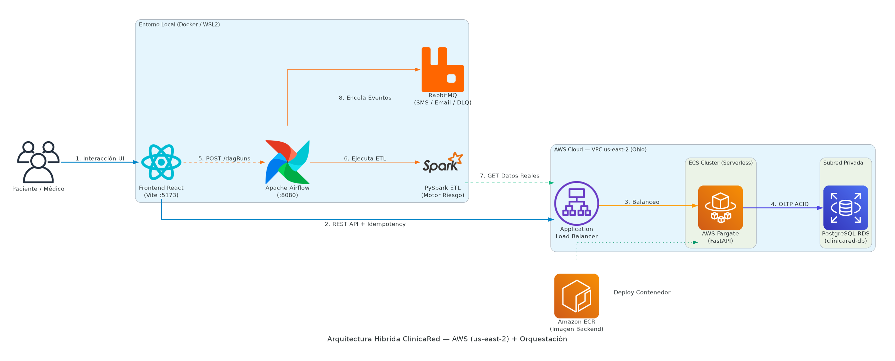

# Arquitectura End-to-End v2 - ClínicaRed en AWS

## 1. Visión General
El sistema **ClínicaRed Citas** implementa una arquitectura híbrida, distribuida y *Serverless* para contenedores, con su núcleo transaccional alojado en la región **AWS US East (Ohio — `us-east-2`)**. Se separan físicamente las responsabilidades transaccionales síncronas (**OLTP**) de los procesos asíncronos y cargas de trabajo de ingeniería de datos (**OLAP**).

Según lo definido en la evaluación de infraestructura (**ADR 005**), se seleccionó la **Opción A - Contenedores ECS** con un costo base mensual estimado de **$50.12 USD** (optimizado mediante encendido y apagado bajo demanda), complementado con orquestación analítica en contenedores Docker locales para mantener en **$0.00 USD** el cómputo de procesamiento durante la fase de validación (ver proyección a operación continua 24/7 en el **ADR 010**).

## 2. Diagrama de Arquitectura (v2)

## 3. Componentes Principales y Costos Detallados

### 3.1 Capa Transaccional en AWS (Fuente de Datos y API — OLTP)
Capa alojada en **AWS `us-east-2`**, encargada del tráfico en tiempo real, validación de reglas de negocio (ej. *overbooking*), control de idempotencia y persistencia inmediata.

- **Amazon ECR (Elastic Container Registry):** Repositorio privado de imágenes Docker donde se versiona y distribuye la imagen productiva del backend FastAPI hacia el clúster de ECS.
- **Application Load Balancer (ALB):** **$16.66 USD/mes**. Punto de entrada público (`clinicared-alb`) que enruta el tráfico API desde el cliente web y las consultas analíticas hacia los contenedores de backend.
- **AWS Fargate (Amazon ECS):** **$18.02 USD/mes**. Ejecución *Serverless* del contenedor principal de la API en **FastAPI**. Configurado con sistema operativo Linux, arquitectura `x86_64`, 1 tarea constante (730 horas/mes), 1 GB de memoria asignada y 20 GB de almacenamiento efímero.
- **Motor de Base de Datos (Amazon RDS for PostgreSQL):** **$15.44 USD/mes**. Sustituye al contenedor de Docker local. Configurado con una instancia `db.t3.micro` OnDemand (Single-AZ) dentro de una subred privada de la VPC (`clinicared-db`), alojando 20 GB de almacenamiento SSD de uso general (`gp2`).
- **Reglas de Negocio e Idempotencia:** Endpoints protegidos mediante validación de cabecera `X-Idempotency-Key` para garantizar atomicidad ACID y evitar registros duplicados ante reintentos de red.

### 3.2 Capa de Mensajería (Message Broker)
Sistema nervioso central que permite la comunicación asíncrona entre el orquestador y los trabajadores en segundo plano.

- **RabbitMQ (`$0.00 USD/mes` en contenedor Docker bajo demanda):** Actúa como intermediario para los *workers* de Celery y las colas de mensajería clínica (`queue.reminders.sms`, `queue.reminders.email` y cola de respaldo ante fallos `clinicared.reminders.dlq`), reteniendo los mensajes de forma persistente en disco hasta su procesamiento.

### 3.3 Capa de Orquestación y Procesamiento Analítico (OLAP)
Aislada completamente del backend transaccional para evitar que el procesamiento masivo afecte los tiempos de respuesta de la API clínica.

- **Orquestador (Apache Airflow + Celery — `$0.00 USD/mes` bajo demanda):** Ejecutándose en contenedores Docker aislados. Planifica los DAGs (`dag_daily_risk_calculation`, `dag_admissions_consolidation` y `dag_reminder_orchestration`) y expone su API REST (`POST /dagRuns`) para disparar recálculos bajo demanda desde el Portal Médico.
- **Motor Analítico (PySpark — `etl_risk_engine.py`):** Extrae en tiempo real los registros de pacientes y citas directamente desde el **AWS ALB** (`GET /patients/` y `GET /appointments/`), realiza limpieza de datos nulos, cruces (`inner join`) y agregaciones matemáticas para calcular el historial de inasistencias (*no-show*) y la recencia de visitas.
- **DataMart Operacional:** Consolida los resultados analíticos exportados por PySpark (`output_risk_data` en formato CSV estructurado) para alimentar el semáforo de riesgo en tiempo real sin sobrecargar la base de datos transaccional `RDS`.