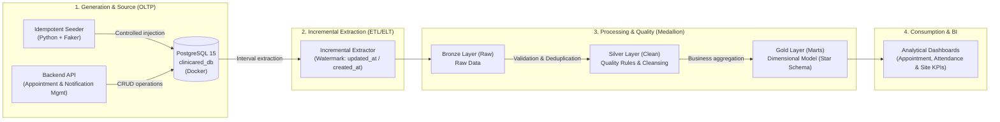

# End-to-End Architecture v1 - ClínicaRed Citas

## 1. Overview
The **ClínicaRed Citas** system implements a hybrid architecture that separates transactional processing (OLTP) from the analytical data engineering pipeline (OLAP). The design ensures high availability for medical appointment management, attendance tracking and messaging, data quality traceability, and scalability through containers.

## 2. Architecture Diagram (v1)

## 3. Core Components

### 3.1 Transactional Layer (Data Source)
- **Database Engine:** PostgreSQL (`postgres:15-alpine`) running inside an isolated Docker container and automatically provisioned via `01_init_schema.sql`.
- **Relational Schema (3NF):**
  * **Master Catalogs:** `locations` (clinic sites) and `specialties` (medical specialties).
  * **Operational & Relationship Entities:** `professionals` (physicians), `patients`, and the bridge table `professional_specialties` (many-to-many relationship).
  * **Transactional Core:** `appointments` (appointment scheduling), `attendances` (attendance control, check-in, and clinical notes), and `messages` (log of notifications and reminders sent to patients).
- **Reliable Temporal Auditing:** `created_at` and `updated_at` columns backed by native PL/pgSQL triggers (`update_updated_at_column()`) to guarantee accurate capture of state changes.
- **Synthetic Generation (`generate_seed.py`):** Idempotent Python script that populates the database and includes a configurable defect-injection parameter for stress-testing data quality pipelines.

### 3.2 Ingestion and Extraction Layer
- **Extraction Strategy:** Watermark-based incremental extraction using audit timestamp columns (`updated_at` / `created_at`) and unique identifiers (`id`) to avoid full table scans, capture status transitions (e.g., cancelled appointments, check-ins in `attendances`, or dispatches in `messages`), and handle late-arriving data.

### 3.3 Analytical Transformation and Storage Layer (Medallion)
- **Bronze (Raw):** Immutable storage of batches extracted from the transactional database.
- **Silver (Clean):** Enforcement of business rules, null handling, format standardization (phone numbers, emails), and quarantine of defective records.
- **Gold (Gold):** Dimensional modeling (Star Schema) optimized for analytical queries covering site performance, specialty demand, notification effectiveness (`messages`), and no-show rates (`attendances` vs. `appointments`).
