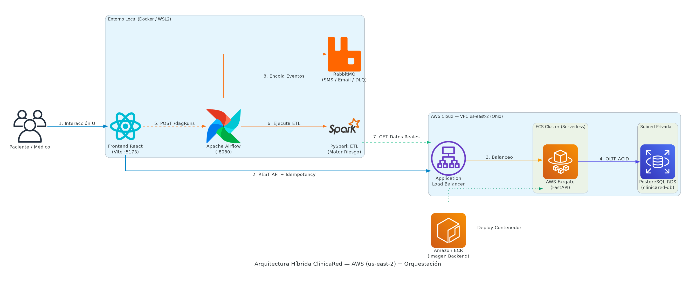

# End-to-End Architecture v2 - ClínicaRed on AWS

## 1. Overview
The **ClínicaRed Citas** system implements a hybrid, distributed, and *Serverless* container architecture with its transactional core hosted in the **AWS US East (Ohio — `us-east-2`)** region. Synchronous transactional responsibilities (**OLTP**) are physically decoupled from asynchronous processes and data engineering workloads (**OLAP**).

As established in the infrastructure evaluation (**ADR 005**), **Option A - ECS Containers** was selected with an estimated base monthly cost of **$50.12 USD** (optimized via on-demand start/stop scheduling), complemented by analytical orchestration in Docker containers to maintain **$0.00 USD** compute cost during the validation phase (see the continuous 24/7 cloud autonomy roadmap in **ADR 010**).

## 2. Architecture Diagram (v2)

## 3. Core Components and Detailed Costs

### 3.1 Transactional Layer on AWS (Data Source & API — OLTP)
Hosted in **AWS `us-east-2`**, handling real-time traffic, business rule validation (e.g., overbooking), idempotency control, and immediate persistence.

- **Amazon ECR (Elastic Container Registry):** Private Docker image registry used to version and distribute the production FastAPI backend image to the ECS cluster.
- **Application Load Balancer (ALB):** **$16.66 USD/month**. Public entry point (`clinicared-alb`) routing API traffic from the web client and analytical queries to backend containers.
- **AWS Fargate (Amazon ECS):** **$18.02 USD/month**. *Serverless* execution of the primary **FastAPI** container. Configured with Linux OS, `x86_64` architecture, 1 continuous task (730 hours/month), 1 GB allocated memory, and 20 GB ephemeral storage.
- **Database Engine (Amazon RDS for PostgreSQL):** **$15.44 USD/month**. Replaces the local Docker container. Configured as a `db.t3.micro` On-Demand instance (Single-AZ) inside a private VPC subnet (`clinicared-db`), provisioned with 20 GB of General Purpose SSD storage (`gp2`).
- **Business Rules & Idempotency:** Endpoints protected via `X-Idempotency-Key` header validation to ensure ACID atomicity and prevent duplicate records under network retries.

### 3.2 Messaging Layer (Message Broker)
Central nervous system enabling asynchronous communication between the orchestrator and background workers.

- **RabbitMQ (`$0.00 USD/month` on-demand Docker container):** Acts as message broker for Celery workers and clinical notification queues (`queue.reminders.sms`, `queue.reminders.email`, and the dead-letter fallback queue `clinicared.reminders.dlq`), persisting messages on disk until processed.

### 3.3 Orchestration and Analytical Processing Layer (OLAP)
Completely isolated from the transactional backend so heavy batch processing never degrades clinical API response times.

- **Orchestrator (Apache Airflow + Celery — `$0.00 USD/month` on-demand):** Running in isolated Docker containers. Schedules DAGs (`dag_daily_risk_calculation`, `dag_admissions_consolidation`, and `dag_reminder_orchestration`) and exposes its REST API (`POST /dagRuns`) to trigger on-demand recalculations from the Medical Portal.
- **Analytical Engine (PySpark — `etl_risk_engine.py`):** Fetches live patient and appointment records directly from the **AWS ALB** (`GET /patients/` and `GET /appointments/`), performs null cleansing, joins (`inner join`), and mathematical aggregations to compute no-show history and visit recency.
- **Operational Data Mart:** Consolidates analytical outputs exported by PySpark (`output_risk_data` in structured format) to power real-time risk indicators without overloading the transactional `RDS` database.
